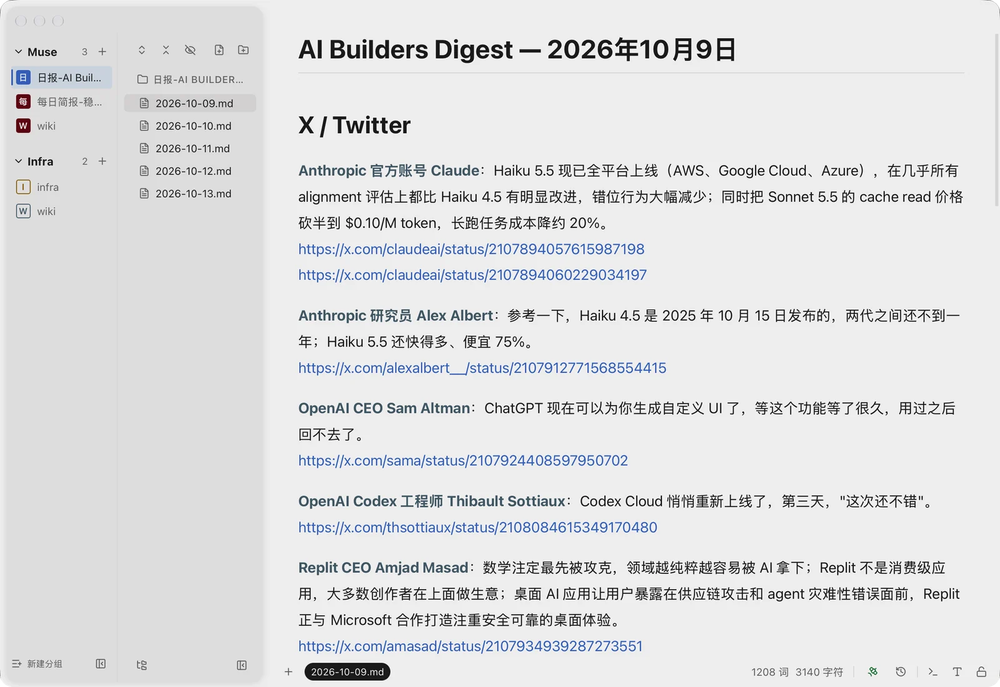
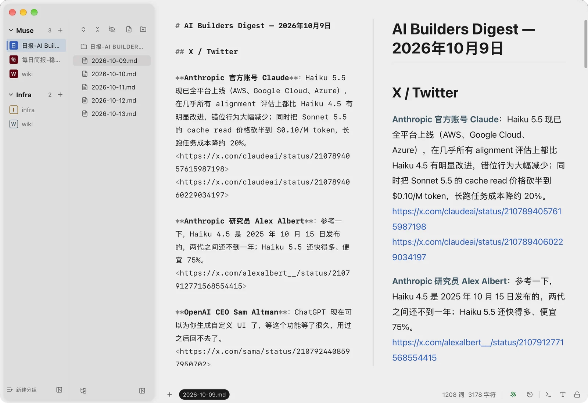
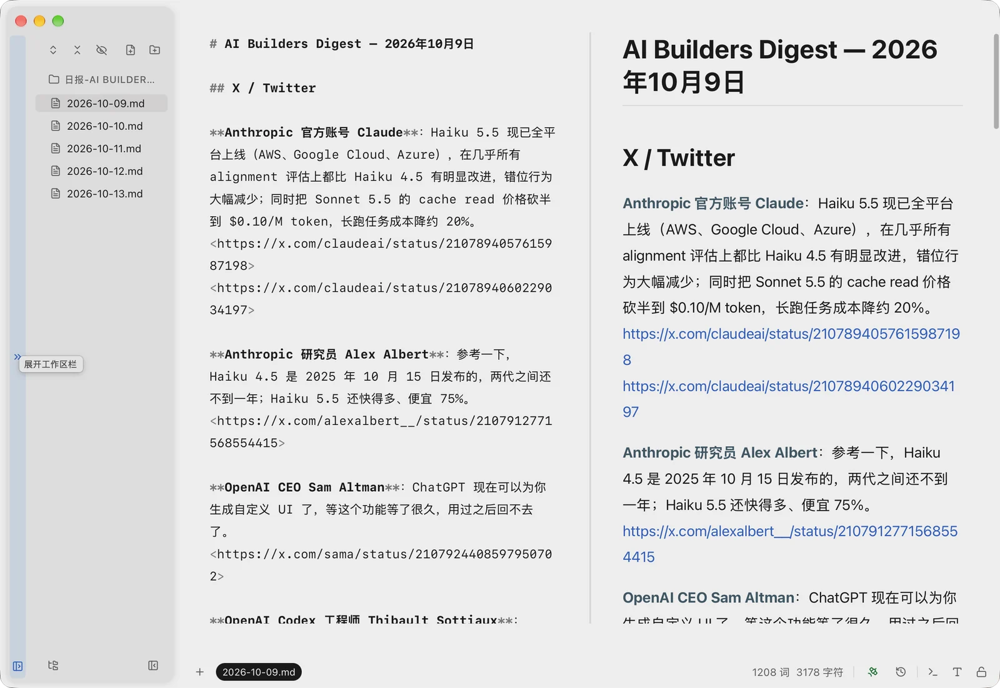
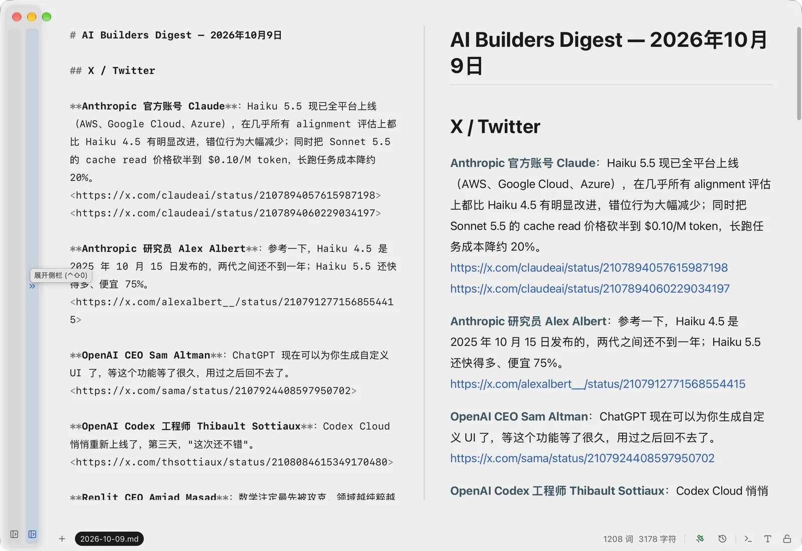

# XMark

<p align="center"></p>

**简体中文** · [English](README.en.md)

**一个你和 AI 共用的纯文本工作台，围绕你的文件夹来组织。**

XMark 是一款免费、数据只存在本机的 macOS 编辑器。你和 AI 助手读写的是同一批文件：Markdown、YAML、JSON、TOML、Mermaid、SVG、HTML 和代码。XMark 用「工作区 · 文件树 · 文档」三栏布局，让多个项目文件夹随手可切换。

**[下载 macOS 版](https://github.com/xiezhaoye/xmark/releases/latest)** · **[更新日志](CHANGELOG.md)** · **[反馈问题](https://github.com/xiezhaoye/xmark/issues)**

> XMark 是 [VMark](https://github.com/xiaolai/vmark)（作者 Xiaolai Li）的非官方分支版本，与原作者无关，也未获得原作者的认可或背书。使用 XMark 遇到问题，请在**本仓库**反馈，不要提交到原项目。

---

<!-- landing -->
**官网：[xmark.xiezhaoye.site](https://xmark.xiezhaoye.site/)**

- **文件夹，就是你的工作台**：打开项目文件夹再按习惯整理，多个工作区随手切换，分组重启后保留。
- **你和 AI，看同一份文件**：通过 MCP 连接 Claude、Codex 等助手，在同一批文件上协作，少些来回复制。
- **想看排版，也能回到源码**：Markdown 可视化编辑、F5 源码快看、F6 完整源码；源码与预览并排。





<p> </p>

## XMark 新增了什么

**三栏布局**：工作区 · 文件树 · 文档

- 第一栏按**完整的文件夹名**列出已打开的工作区，鼠标悬停可以看到完整路径；拖动右边缘可以调整宽度。
- 复制到新窗口、移到新窗口、关闭都放在右键菜单里，不会再误点。

**工作区分组**

- 点第一栏底部的**新建分组**。在工作区上右键，或点分组右侧的 **+**，把文件夹加进分组；同一个文件夹可以属于多个分组。
- 点分组名展开或收起。分组重启后依然保留；还没打开的文件夹以空心图标显示，点一下就能打开。
- 没有归入任何分组的已打开工作区，显示在**未分组**里。

**可以收起的栏位**

- 两个侧栏都能收起成一条窄竖条，点竖条任意位置即可展开；`Cmd+\` 收起或展开文件栏。

**细节优化**

- **设置 → 外观 → 侧栏文字大小**（13–16 px），同时作用于前两栏。
- 在文件树里点文件夹那一行就能展开或收起；行不能拖动，触控板轻点一次就生效。
- 文件树工具栏更清爽：文件 / 大纲 / 历史记录的切换放在底部，「显示全部文件」改为眼睛图标。

## XMark 同样具备

以下功能来自 VMark，在 XMark 里用法相同。

- **多种格式**：Markdown 可以所见即所得编辑，也可以看源码；另外支持 JSON / JSONL、YAML、TOML、Mermaid、SVG、安全隔离的 HTML 和纯文本。代码文件（.ts、.py、.rs、.go、.css 等）默认高亮只读，点一下即可编辑，也可以交给你自己的编辑器打开。
- **配置文件智能预览**：GitHub Actions 工作流显示为任务关系图；`Cargo.toml`、`package.json`、`pyproject.toml` 以树状显示依赖；其他 JSON、YAML、TOML 显示为可展开浏览的树。
- **为 AI 而生**：通过 MCP 连接 Claude Desktop、Claude Code、Codex CLI、Antigravity CLI、Grok CLI、opencode、Pi 和 DeepSeek Harness，让 AI 和你在同一批文件上工作；内置的 AI 精灵可以在你写作的地方直接帮忙。
- **三种 Markdown 写法**：可视化编辑、`F5` 快速查看源码、`F6` 完整源码编辑。
- **多光标**：`Mod + D` 选中下一个相同内容，`Alt + 点击` 添加光标，`Mod + Alt + ↑↓` 在上下行添加光标。
- **智能括号**：括号和引号自动补全，按 Tab 跳到右括号之后。
- **为中日韩文字优化**：20 多条排版规则，处理中日韩文字与英文混排。
- **10 种界面语言**：English · 简体中文 · 繁體中文 · 日本語 · 한국어 · Deutsch · Español · Français · Italiano · Português (Brasil)。
- **6 套主题**：macOS 上有 White、Paper、Mint、Sepia、Night、Solarized；Windows 和 Linux 提供 White 和 Night。
- **数据只在本机**：没有云端、没有账号、不做统计，文件始终留在你的电脑上。
- **快捷键**：每一个都可以在设置里修改。

---

## 下载

在 [Releases](https://github.com/xiezhaoye/xmark/releases/latest) 下载最新的 `.dmg`。XMark 适用于 Apple 芯片（M1 及更新）的 Mac。

这个安装包没有经过 Apple 公证，所以 macOS 会拦截**第一次**打开。把 XMark 拖进「应用程序」后，先打开一次，再到 **系统设置 → 隐私与安全性**，在 XMark 的提示旁点 **仍要打开**。也可以在终端里执行：

```bash
xattr -dr com.apple.quarantine /Applications/XMark.app
```

之后就能正常打开，并在 App 内自动更新。XMark 可以和 VMark 同时安装，两者的设置和更新互不影响。

---

## AI 集成

XMark 通过 [MCP](https://modelcontextprotocol.io/) 连接 AI 助手。打开 **设置 → 集成**，在对应的助手旁点 **安装** 即可。

支持：Claude Desktop、Claude Code、Codex CLI、Antigravity CLI、Grok CLI、opencode、Pi、DeepSeek Harness。

XMark 在 AI 助手配置里的名字是 `xmark`，不会和已安装的 VMark 冲突。

---

## 常见问题

**XMark 与 VMark 是什么关系？**  
XMark 是 Xiaolai Li 的 VMark 的非官方分支，沿用 ISC 协议，与原作者无关，也未获得其认可或背书。

**文件会上传到云端吗？**  
不会。XMark 以本机文件为基础，没有云端账号；连接 AI 助手或模型服务时，内容由你配置的服务处理。

**手机端能直接下载吗？**  
目前不能。XMark Mobile 需自行用 Xcode 构建，通过 Tailscale 连接自己的电脑，只读浏览。

## 反馈

发现问题或有想法？欢迎提交 [issue](https://github.com/xiezhaoye/xmark/issues)。请写清楚你做了什么、期望看到什么、实际发生了什么；附上截图会更好。

---

## 从源码构建

**需要：** [Node.js](https://nodejs.org/) 22 或 24（Node 25 会被部分依赖拒绝）、[pnpm](https://pnpm.io/) 10、[Rust](https://www.rust-lang.org/tools/install) 1.89 或更新版本，以及 [Tauri v2 的系统依赖](https://v2.tauri.app/start/prerequisites/)。

```bash
git clone https://github.com/xiezhaoye/xmark.git
cd xmark
pnpm install

# 先构建一次 MCP 辅助程序，新克隆的仓库里没有它
pnpm --dir server/mcp build:sidecar

pnpm tauri:dev        # 运行开发版
pnpm tauri build      # 打包 App
```

**技术栈：** Tauri v2（Rust）、React 19、TypeScript、Zustand v5、Tiptap、CodeMirror 6、Tailwind CSS v4。

---

## 致谢与许可协议

XMark 基于 Xiaolai Li 的 [VMark](https://github.com/xiaolai/vmark) 开发，感谢原作者将它开源。

XMark 沿用与 VMark 相同的 [ISC 协议](LICENSE)：可以自由使用、复制、修改和分发。原作者的版权声明完整保留；XMark 所做的修改版权归 xiezhaoye 所有（Copyright (c) 2026 xiezhaoye）。
